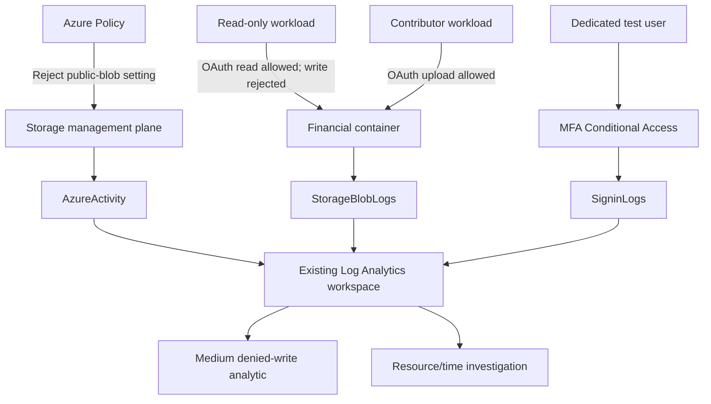

# Architecture

## Azure data path

During validation, the private `financial-records` container held `Financial_Records_CONFIDENTIAL.docx`. Storage used Microsoft-managed keys, infrastructure encryption, TLS 1.2, disabled shared-key authorization, and a default-deny network rule with one operator IP. The account had a public endpoint; it was not a private-endpoint deployment. The dedicated Azure resource group was deleted after the evidence was committed, while the Bicep definitions remain reproducible.

During validation, two dedicated workload identities separated management-plane and data-plane permissions. Reader/Contributor applied to the lab resource group; Blob Data Reader/Contributor applied only to the financial container. Neither test identity had Owner or role-assignment authority. The identities remain credential-free, and their Azure role assignments were removed during teardown.

## Separate SharePoint path

The dedicated SharePoint site contains the same synthetic financial sample and a nonsensitive sharing-control file. The historical credit-card path remains preserved as an ambiguous behavioral test: an authenticated guest opened the control file, while the financial file returned an organizational-policy access block without naming that historical rule.

The reproducible validation path uses a site-scoped Purview policy with the lab-only `LAB-FIN-########` sensitive-information type. Simulation matched the financial document, and the same policy later reached enforcement. Activity Explorer and Unified Audit named the isolated policy, rule, classifier, and `BlockAccess`; the control file opened while the financial file was blocked. The diagnostic policy was disabled and retained after cleanup. No SharePoint DLP event or Defender endpoint event was correlated into Sentinel in the recorded run.

This SharePoint path is separate from Blob Storage and the Entra password-grant test.

## Trust boundaries

- OAuth authorization and network authorization are separate checks. The firewall test changed only the dedicated account allowlist, then restored it.
- Resource/time correlation joins the same storage account within five minutes. It does not equate the configuration caller with the data requester.
- Source IP can represent NAT, VPN, proxy, or security infrastructure. Identity, endpoint, file-audit, and DLP evidence are required for stronger attribution.
- Tenant identity diagnostics and the lab subscription Activity diagnostic fed an existing workspace during validation. Both lab-created feeds were removed during teardown. The pre-existing shared workspaces and their unrelated diagnostic configuration remain.
