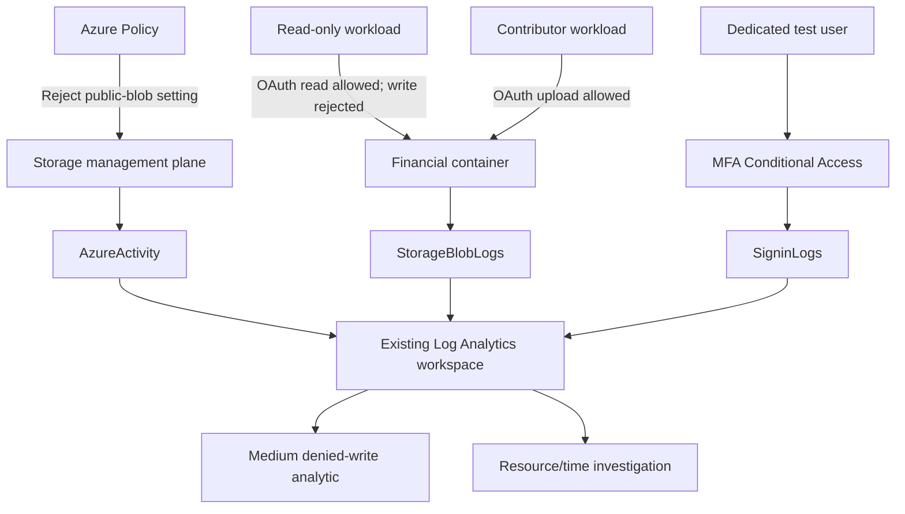

# Architecture

## Azure data path

The private `financial-records` container holds `Financial_Records_CONFIDENTIAL.docx`. Storage uses Microsoft-managed keys, infrastructure encryption, TLS 1.2, disabled shared-key authorization, and a default-deny network rule with one operator IP. The account still has a public endpoint; it is not a private-endpoint deployment.

Two dedicated workload identities separate management-plane and data-plane permissions. Reader/Contributor apply to the lab resource group; Blob Data Reader/Contributor apply only to the financial container. Neither test identity has Owner or role-assignment authority.

## Separate SharePoint path

The dedicated SharePoint site contains the same synthetic financial sample and a nonsensitive sharing-control file. A Purview rule targets credit-card content shared outside the organization. An authenticated guest opened the control file after audit ingestion was enabled; the financial file returned an organizational-policy access block. The page did not name the Purview rule, and no authoritative DLP record was returned in the observation window.

This SharePoint path is separate from Blob Storage and the Entra password-grant test. No SharePoint DLP event or Defender endpoint event was correlated into Sentinel in the recorded run.

## Trust boundaries

- OAuth authorization and network authorization are separate checks. The firewall test changed only the dedicated account allowlist, then restored it.
- Resource/time correlation joins the same storage account within five minutes. It does not equate the configuration caller with the data requester.
- Source IP can represent NAT, VPN, proxy, or security infrastructure. Identity, endpoint, file-audit, and DLP evidence are required for stronger attribution.
- Tenant identity diagnostics and subscription Activity diagnostics feed an existing workspace. Investigation queries restrict the lab scope; collection itself is broader.
