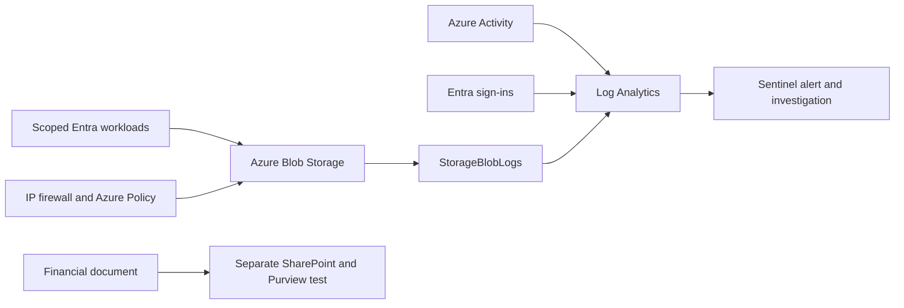

# Azure Data Exfiltration Defense Lab

I tested storage, identity, and detection controls around a dedicated financial-records container and SharePoint site.

**Sample uses synthetic financial data only.**

## Architecture

## Controls tested

| Control | Result |
| --- | --- |
| Scoped RBAC | Reader downloaded the file but could not overwrite it. Contributor uploaded data but could not grant roles. |
| Storage access | Anonymous and shared-key requests were rejected. Removing the allowed IP blocked an authorized reader; restoring it restored access. |
| Azure Policy | Public-blob enablement was rejected. The classification audit passed after I added the required tag. |
| MFA | Password-only authentication succeeded in report-only mode and failed when the lab MFA policy was enabled. |
| Sentinel | A denied write produced a native Medium alert and incident. |
| Investigation | I correlated three denied reads with preceding changes on the same storage account. |
| SharePoint DLP | The isolated site-scoped policy matched the synthetic financial identifier in Simulation and Enforce. Activity Explorer and Unified Audit named the isolated policy, rule, classifier, and `BlockAccess`; the control file opened and the financial file was blocked. The older credit-card path remains historical. |
| Isolated Purview simulation and enforcement | `Financial_Records_CONFIDENTIAL.docx` matched `Lab Financial Record ID` in Simulation, then the same rule reached `Enable`/`Success` and produced authoritative `BlockAccess` telemetry for the controlled guest comparison. |

## Evidence

[Portal captures and API results](docs/evidence/public/README.md) · [Control matrix](CONTROL_MATRIX.md) · [Validation](VALIDATION.md) · [Architecture](ARCHITECTURE.md) · [KQL](docs/kql/README.md) · [Bicep](infra/)

## What remains

The isolated guest run demonstrated the intended file-level difference, and Purview Activity Explorer plus Unified Audit named the isolated rule and `BlockAccess` action. The earlier credit-card path remains a separate historical limitation, including its `PendingDeletion` rule. The [Purview record](PURVIEW_DLP.md) keeps those results distinct. Defender endpoint correlation and USB/Bluetooth controls remain outside the tested release.

A blocked request does not prove every exfiltration path is closed. Authorized downloads remain possible, and resource/time correlation does not identify a person. [Limitations](LIMITATIONS.md) lists the remaining boundaries.

## Related project

**Lab state: RETAINED FOR CONTINUED VALIDATION.**
