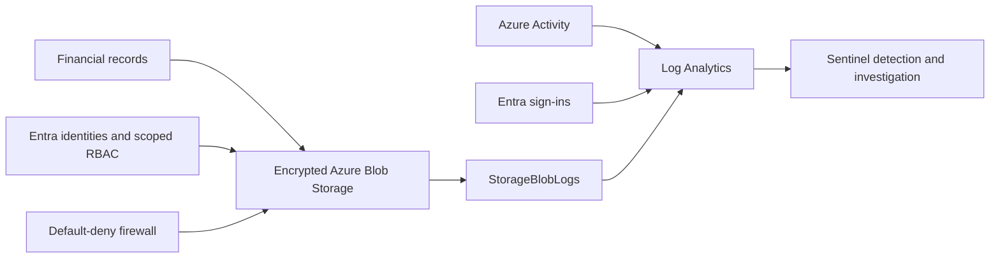

# Azure Data Exfiltration Defense Lab

Azure storage, identity, and detection controls tested against a dedicated financial-records container and lab identity.

**All financial data used in this lab is synthetic test data.**

## Observed results

- A Reader could read the financial document but could not overwrite it. A Contributor changed the account but could not grant access.
- Anonymous access and shared-key authentication were rejected. Removing the allowed network address blocked an otherwise authorized reader; restoring it restored access.
- Azure Policy rejected a public-blob setting change. The classification audit moved from noncompliant to compliant after remediation.
- The dedicated user's password-only sign-in succeeded in report-only mode. Enforced MFA rejected it with error 50079; the sign-in record named the lab policy.
- A KQL investigation linked three denied requests to preceding account changes on the same resource within five minutes.
- SharePoint rejected anonymous links for both the financial file and a nonsensitive control file because site sharing was disabled. This does **not** prove a DLP block.

## Detection scope

The Sentinel rule **Financial records - denied blob write** treats a rejected financial-container write as Medium severity and groups incidents by storage resource. Its deployment and observed runtime outcome are recorded in [validation](VALIDATION.md).

Purview's external-access rule is configured on one dedicated SharePoint site. Content-specific enforcement, endpoint DLP, USB restrictions, and Defender endpoint telemetry remain **NOT VALIDATED**.

This lab does not prove exfiltration or identify a person behind an IP address. Successful authorized downloads remain possible. It complements DLP, encryption, access controls, EDR, and SIEM monitoring.

## Evidence and implementation

[Control matrix](CONTROL_MATRIX.md) · [Validation](VALIDATION.md) · [Evidence](docs/evidence/public/README.md) · [Architecture](ARCHITECTURE.md) · [KQL](docs/kql/README.md) · [Bicep](infra/) · [Security](SECURITY.md)

The [Honey Token Detection](https://github.com/oasunsec/honey-token-detection) project supplies a separate deception signal. No combined honeytoken-to-DLP or endpoint incident is claimed here.

**Lab state: RETAINED FOR CONTINUED VALIDATION.**
