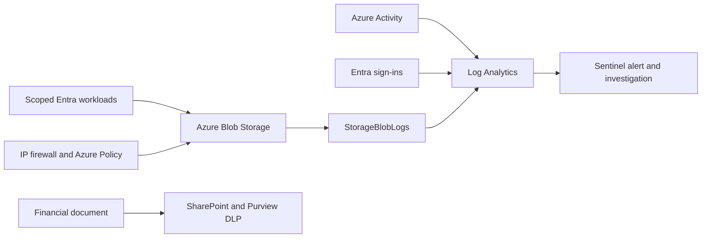

# Azure Data Exfiltration Defense Lab

I put a synthetic financial document in Azure Blob Storage and in a SharePoint site, then tested the controls that are supposed to keep it from leaving: storage authentication and network rules, scoped RBAC, Azure Policy, MFA, a Sentinel detection, and Purview DLP. Each control was tested with a real request, and the result was saved as a redacted portal capture or trimmed API and KQL output. The Azure resources were deleted afterwards.

All data in the lab is synthetic.



## What I tested

| Control | Test | Result |
| --- | --- | --- |
| Scoped RBAC | Read and write the file as a Reader identity, then as a Contributor | Reader could download but not overwrite. Contributor could upload but could not grant roles. |
| Anonymous and shared-key access | Request the blob with no auth, then with the real account key | Both rejected (`PublicAccessNotPermitted`, `KeyBasedAuthenticationNotPermitted`). |
| Network firewall | Remove the reader's IP from the allowlist, retry, restore it | Allowed, then 403, then allowed again. |
| Azure Policy | Try to turn on public blob access; leave off the classification tag | The change was denied. The tag audit went from noncompliant to compliant once the tag was added. |
| MFA | Password-only sign-in with the Conditional Access policy in report-only mode, then enforced | Succeeded in report-only mode. Failed with error 50079 when enforced. |
| Sentinel detection | Have the read-only identity attempt a write | The 403 raised a native Medium alert and incident 19. |
| Investigation | Join storage account changes with denied reads | Three denied reads matched an account change on the same account within five minutes. |
| SharePoint DLP | Share the financial file and a harmless control file with an external guest | The custom classifier matched in simulation, then in enforcement. The guest could open the control file and was blocked from the financial file. |

Full detail: [results](docs/results.md) · [control matrix](docs/control-matrix.md) · [evidence](docs/evidence/public/README.md)

## What I learned

- **Disabling Shared Key is not the same as hiding the key.** Requests signed with the key were rejected, but an operator with management rights could still list the key. Data-plane and management-plane permissions are separate.
- **The built-in credit card classifier was hard to prove.** My first DLP rule used it. The guest got a generic "You can't access this site" page, and no log record named the rule that blocked it. So I wrote a custom sensitive information type for a made-up `LAB-FIN-########` ID and a separate site-scoped policy. That run left records in Activity Explorer and Unified Audit naming the policy, rule, classifier, file and `BlockAccess`.
- **Sentinel did not see the DLP events.** The workspace had no Purview or Office 365 connector, so the DLP result is documented on its own and not joined to the storage incident.
- **A time-and-resource join is not attribution.** The investigation query shows that a denied read followed a change on the same account. It does not show that the same person made both, or why.

## Not covered

No endpoint was onboarded to Defender, so Endpoint DLP, USB and Bluetooth blocking, clipboard and print controls, and endpoint correlation were not tested. MFA was tested by rejecting a password-only sign-in, not by completing an MFA prompt. The storage account used a public endpoint with an IP firewall, not a private endpoint. See [limitations](docs/limitations.md).

## Repository

| Path | Contents |
| --- | --- |
| [infra/](infra/) | Bicep for storage, policy and the Sentinel analytic, and a Conditional Access template |
| [scripts/](scripts/) | DLP setup, the synthetic sample generator, a storage baseline check and a public-file privacy check |
| [docs/kql/](docs/kql/README.md) | Investigation and detection queries |
| [docs/evidence/public/](docs/evidence/public/README.md) | Redacted screenshots and trimmed JSON results |
| [tests/](tests/) | Tests for the baseline check, privacy filter, sample generator and DLP setup safeguards |

Write-ups by area: [storage](docs/azure-storage.md) · [MFA](docs/mfa.md) · [Purview DLP](docs/purview-dlp.md) · [Sentinel](docs/sentinel.md) · [architecture](docs/architecture.md) · [testing](docs/testing.md)

## Run the checks

```sh
python -m pip install -r requirements.txt
python -m pytest -q
python scripts/check_public_files.py
```

The DLP tests need PowerShell 7. CI also compiles the Bicep templates and runs Gitleaks over the full history. It has no Azure credentials and does not touch the lab.

## Teardown

After the evidence was committed, I deleted the resource group, role assignments, diagnostic settings, policy objects and the Sentinel analytic. The Purview policy, the custom classifier and the SharePoint samples were kept (the policy disabled) so the DLP test can be repeated. See [teardown](docs/teardown.md).

## License

[MIT](LICENSE)
