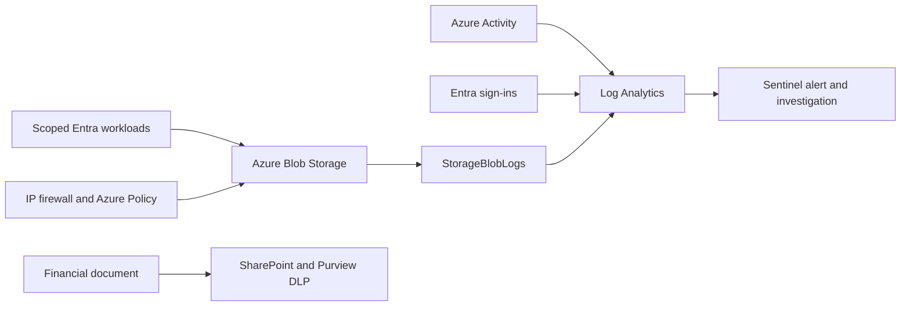

# Azure Data Exfiltration Defense Lab

This lab demonstrates storage, identity, detection, and SharePoint data-loss-prevention controls using synthetic financial data.

## Architecture

## Results

| Control | Observed result |
| --- | --- |
| Scoped RBAC | The Reader downloaded the file but could not overwrite it. The Contributor uploaded data but could not grant roles. |
| Storage access | Anonymous and shared-key requests were rejected. An authorized reader was blocked outside the IP allowlist and restored after the rule was restored. |
| Azure Policy | Public-blob enablement was rejected. The classification audit passed after the required tag was applied. |
| MFA | Password-only authentication succeeded in report-only mode and failed when the lab MFA policy was enabled. |
| Sentinel | A denied write produced a native Medium alert and incident. Three denied reads correlated with preceding storage-account changes. |
| SharePoint DLP | The custom `Lab Financial Record ID` matched in simulation. Activity Explorer and Unified Audit then named the isolated policy, rule, file, classifier, and `BlockAccess`. |
| Guest comparison | `Sharing_Control.txt` opened and `Financial_Records_CONFIDENTIAL.docx` was blocked. This 20:30 UTC comparison is separate from the 20:24 UTC Purview records. |

## Evidence and implementation

[Evidence](docs/evidence/public/README.md) · [Control matrix](CONTROL_MATRIX.md) · [Test results](VALIDATION.md) · [Architecture](ARCHITECTURE.md) · [KQL](docs/kql/README.md) · [Bicep](infra/)

## Scope

The evidence covers the isolated SharePoint DLP scenario and the Azure, identity, and Sentinel controls listed above. Endpoint DLP, USB/Bluetooth controls, Defender endpoint correlation, and universal exfiltration prevention were outside the test scope. The historical credit-card DLP rule is documented separately and is not used to support the isolated-policy result. See [limitations](LIMITATIONS.md).

## Teardown

Dedicated Azure resources, lab-created ingestion feeds, scoped Azure role assignments, custom Azure Policy objects, and the Sentinel analytic were removed after evidence capture. The isolated Purview policy is retained disabled, and the historical `PendingDeletion` object is unchanged. See [cost and teardown](COST_AND_TEARDOWN.md).
