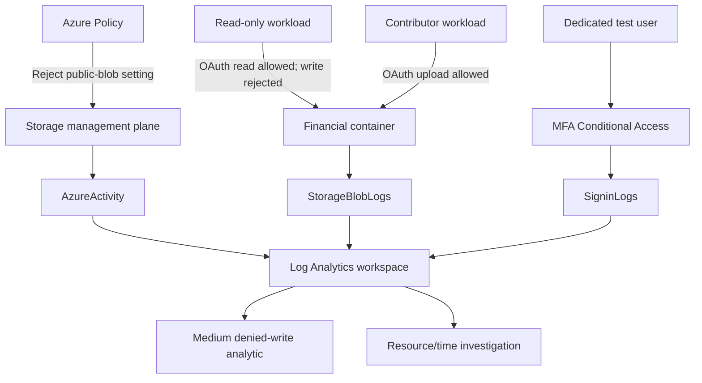

# Architecture

## Azure storage

The private `financial-records` container held `Financial_Records_CONFIDENTIAL.docx`. The storage account used Microsoft-managed keys with infrastructure encryption, required TLS 1.2, rejected shared-key requests, and denied network access except from one operator IP. It still had a public endpoint; this was not a private-endpoint setup.

Two workload identities split the permissions. One had Reader on the resource group and Blob Data Reader on the container. The other had Contributor and Blob Data Contributor. Neither could assign roles. Both identities have no credentials now, and their role assignments were removed at teardown.

The resource group was deleted after the evidence was committed. The Bicep files can rebuild it.

## SharePoint

A dedicated SharePoint site holds the same synthetic financial document and a harmless control file. A site-scoped Purview policy uses a custom classifier for the made-up `LAB-FIN-########` ID. The policy matched in simulation, then blocked the financial file in enforcement while the control file still opened. The policy is now disabled.

An earlier attempt used the built-in credit card classifier. It blocked the guest too, but nothing in the logs named the rule, which is why I built the custom classifier. See [Purview DLP](purview-dlp.md).

The SharePoint test is separate from the storage and MFA tests.

## Trust boundaries

- OAuth authorization and the network firewall are separate checks. The firewall test changed only this account's allowlist and then put it back.
- The investigation query joins events on the same storage account within five minutes. The account that changed a setting is not assumed to be the one that made the data request.
- An IP can belong to NAT, a VPN, a proxy or a security service. Telling who did something needs identity, endpoint, file-audit and DLP records together.
- Lab diagnostic settings sent logs to a Log Analytics workspace that other projects also use. I removed the lab's settings at teardown and left the workspace alone.
